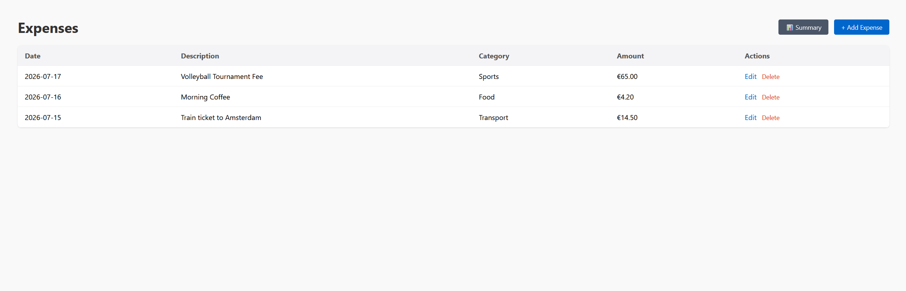
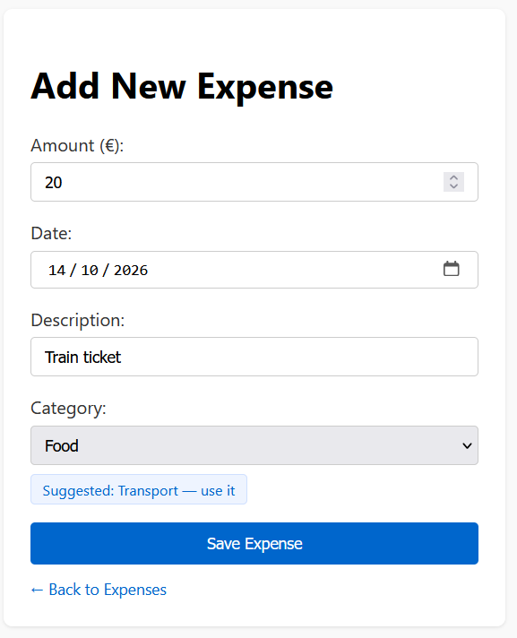
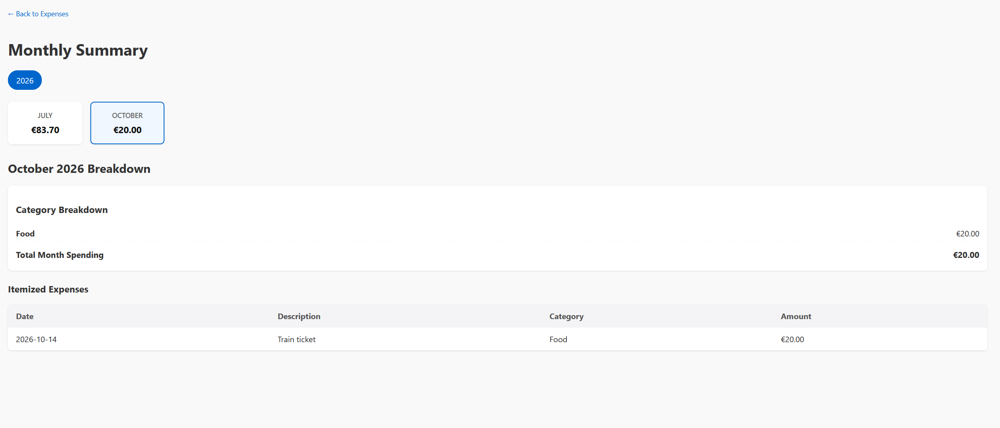

# Personal Expense Tracker

**By Kerem Yildirim**

A small web app for writing down what I spend, sorting it into categories, and seeing how much I spent each month. When I type a description like "Morning coffee", an AI offers a category. I decide whether to use it.

I built it step by step as a learning project: Flask and SQLite first, then validation, the AI suggestion, and finally Docker.



| Add an expense, with an AI suggestion | Monthly summary |
|---|---|
|  |  |

## What it can do

- Add, edit and delete expenses (deleting asks "are you sure?" first).
- See all expenses on one page, newest first.
- Open a summary: pick a year, then a month, and see the month's total, the total per category, and every expense in that month.
- Get a category suggestion from an AI while adding an expense. It shows up as a button you can click, or ignore.
- Run it on your own computer, or inside Docker.

## Built with

- **Python 3.12** and **Flask** for the web app
- **SQLite** for the database (one file, no server to install)
- **Jinja2 templates** with plain HTML and CSS, and a little JavaScript for the AI suggestion
- **Anthropic API** (Claude Haiku) for category suggestions
- **Docker** for packaging

## Run it on your computer

You need Python 3.12 (or close to it) and Git. The AI key is optional: without it, everything works except the suggestion button.

**1. Get the code**

```bash
git clone https://github.com/keremyldrm41/expense-tracker.git
cd expense-tracker
```

**2. Make a virtual environment and install the libraries**

Windows (PowerShell):

```powershell
python -m venv .venv
.venv\Scripts\Activate.ps1
pip install -r requirements.txt
```

If PowerShell says "running scripts is disabled on this system", allow scripts for your own user once (`Set-ExecutionPolicy -Scope CurrentUser RemoteSigned`), then run the `Activate.ps1` line again.

macOS / Linux (use `python3` if `python` is not found):

```bash
python -m venv .venv
source .venv/bin/activate
pip install -r requirements.txt
```

**3. Add your API key (optional)**

Copy the example file (`copy .env.example .env` on Windows, `cp .env.example .env` on macOS / Linux), then open `.env` and replace `your-key-here` with your Anthropic API key. If you skip this, the app still works, it just never offers a suggestion.

**4. Create the database, then start the app**

```bash
python init_db.py
python app.py
```

Then open http://127.0.0.1:5000.

The database is created as a file called `expense.db` in the project folder. If you want some sample expenses to look at, run `python init_db.py --seed` instead of the plain command in step 4. **Careful: `--seed` deletes every expense that is already in the database.**

Set `FLASK_DEBUG=1` before `python app.py` if you want Flask's debug mode while developing.

## Run it with Docker

You need Docker Desktop, and it has to be **running** (open it and wait until it says Docker is running), otherwise the commands below fail with an error about not being able to connect to the Docker daemon. Copy `.env.example` to `.env` and put your Anthropic API key in it, as in step 3 above.

```bash
# Build the image (once, and again after code changes)
docker build -t expense-tracker .

# Run it: map the port, pass the API key at runtime, keep the database in a volume
docker run -d --name expense-tracker -p 5000:5000 --env-file .env -v expense-data:/data expense-tracker
```

Then open http://localhost:5000.

- `--env-file .env` gives the API key to the container when it starts. The key is never copied into the image, because `.env` is listed in `.dockerignore`. You can also pass it with `-e ANTHROPIC_API_KEY=...`, but then the key ends up in your shell history.
- `-v expense-data:/data` keeps the database in a Docker volume, so your expenses survive when the container is deleted. Without it, every new container starts empty.
- Inside the container Flask runs with debug off and listens on `0.0.0.0` (set by `FLASK_HOST` in the Dockerfile). That is what lets the port mapping reach it.

To stop and remove the container (your data stays in the volume):

```bash
docker rm -f expense-tracker
```

## Design decisions

**Money is stored as whole cents.** Computers cannot store numbers like 0.10 exactly as decimals, so adding prices as floats can drift by tiny amounts. The database stores €14.50 as the integer `1450`, and the app only turns it back into euros when it shows it on screen. Sums are exact because they are just integer additions.

**The AI suggests, it never decides.** When you leave the description field, the browser asks the server for a category. The server asks the model and accepts the answer only if it is exactly one of my five categories. Anything else (no key, no internet, a timeout after 5 seconds, a strange reply) means no suggestion, and the form simply works as before. A suggestion never fills in or changes the form on its own. You have to click it. The category you save is always the one in the dropdown.

**The server checks everything again.** The browser's `required` and `type="number"` are a convenience, not protection, because anyone can send a request without the form. So the server checks the amount (a real number, above zero, at most €1,000,000), the date format, that the description is not empty, and that the category is one of the allowed ones. Bad input gets a 400 error and nothing is saved. Database queries use `?` placeholders instead of pasting text into the SQL, so typed text cannot change the query.

**The database lives on a volume.** A container's own files disappear when the container is removed. The Dockerfile points the database at `/data`, which is meant to be mounted as a volume, so the data outlives the container. `init_db.py` only creates the table if it is missing (it never deletes anything unless you pass `--seed`), so it is safe to run every time the container starts.

**The API key stays out of the code and out of Git.** It is read from the `ANTHROPIC_API_KEY` environment variable (or a local `.env` file). `.env` is in `.gitignore` and `.dockerignore`, and `.env.example` shows the format with a fake value.

## Known limitations

I would rather say these out loud than have you find them.

- **The error page for bad input is bare.** When validation fails, the server answers with a plain "Bad Request" page and does not say which field was wrong. The browser's own checks catch most mistakes first, but a friendly message next to the right field is still to do.
- **It uses Flask's development server, even in Docker.** It prints a warning that it is not meant for production. That is fine for a personal app on my own machine. A real deployment would use a production server such as Gunicorn behind a reverse proxy. I left it as it is on purpose and am noting the trade-off here.
- **There are no automated tests yet.** I checked the app by hand while building it. Tests for the validation and for the cents-to-euros conversion would be the first thing I add.
- **There is no login.** Anyone who can reach the port can see, change and delete every expense, and the forms have no protection against cross-site requests (CSRF). That is fine on `localhost`, and it means the app should not be put on the open internet as it is.
- **Descriptions have no length limit when saving.** The AI request cuts the description at 200 characters, but the save itself accepts any length.
- **Descriptions are sent to Anthropic.** To get a suggestion, the text you typed in the description field is sent to the Anthropic API. If you do not want that, leave the API key out and the app never makes the request.
- **One user, euros only.** There are no accounts, no other currencies, and the list is not paginated.

## License

MIT, see [LICENSE](LICENSE).
